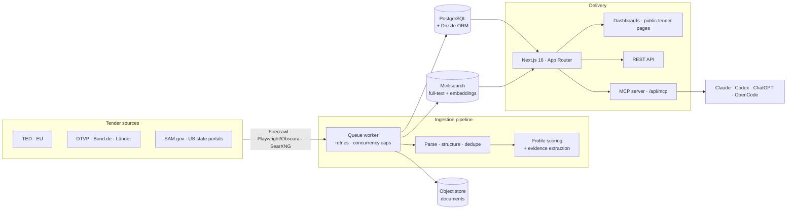

<div align="center">


# TenderHunter

**Public tenders, found early — scored with evidence, not gut feeling.**

[](https://palemaz.com)
[](https://nextjs.org)
[](https://typescriptlang.org)
[](https://postgresql.org)
[](https://meilisearch.com)
[](#mcp-server-for-ai-agents)

*Öffentliche Aufträge. Früh erkannt. Klar bewertet.*

[Live product](https://palemaz.com) · [MCP server](#mcp-server-for-ai-agents) · [Quickstart](#quickstart) · [Architecture](#architecture)

</div>

---

## Why this exists

Public procurement is a huge market that is nearly inaccessible to small and mid-sized companies. Relevant tenders are scattered across TED, DTVP, Bund.de, SAM.gov and dozens of regional portals. The documents are long legal PDFs. And while large vendors staff entire bid teams, a 10-person company has one person — part-time.

TenderHunter closes that gap: it continuously ingests tender sources, structures the documents, scores every opportunity against a company profile, and explains the verdict with verifiable evidence — so a small team can decide in minutes which tenders are worth pursuing.

## What it does

**Discover → Structure → Score → Explain → Deliver**

| Capability | Detail |
|---|---|
| **Multi-market ingestion** | EU (TED), Germany (DTVP, Bund.de, federal states), US (SAM.gov, state & local portals) — crawled on schedule via Firecrawl and Playwright |
| **Profile-based scoring** | Four dimensions per tender and company profile: fit, win probability, effort, and kill-switch (exclusion criteria) |
| **Evidence-first AI** | Every verdict cites its source: document, page, verbatim quote. No black-box scores |
| **Small-vendor barrier detection** | Recognizes references, certificates, capacity lease (*Eignungsleihe*) and subcontractor requirements — the classic reasons SMB bids fail |
| **Document pipeline** | PDF/HTML/ZIP text extraction, deadline tracking, readiness states, deduplication |
| **Agent-ready** | Built-in MCP server so Claude, Codex, ChatGPT and OpenCode query the index directly |
| **Production system** | Auth (Google OAuth), Stripe subscriptions, transactional email alerts, SEO-optimized public tender pages |

### Evidence before optimism

The scoring engine is deliberately conservative: risk signals surface before positive scores, and `not_found` means *"not found in the examined documents"* — never *"requirement doesn't apply."* Verdicts come with checkpoints and quotes so a bid team can verify every claim against the original tender documents.

## MCP server for AI agents

TenderHunter exposes a read-only [Model Context Protocol](https://modelcontextprotocol.io) server at `/api/mcp`, with a JSON facade at `/api/mcp/search` for local scripts:

| Tool | Returns |
|---|---|
| `search_tenders` | Filtered search with `smallVendorFit` sorting, barrier hints, categories |
| `match_tenders` | Candidates scored against a company profile — verdict + evidence per hit |
| `get_tender_dossier` | Notice, documents, ZIP contents, access notes, criteria with citations |
| `get_document_text` | Text excerpts per document and page |

Connect it to Claude Code:

```bash
claude mcp add --transport http tenderhunter https://palemaz.com/api/mcp
```

Or query it from any script with the dependency-free CLI:

```bash
TENDERHUNTER_API_URL=https://palemaz.com/api/mcp/search \
  npm run tenderhunter -- search --query "Gebäudereinigung" --limit 10
```

## Architecture



| Layer | Technology |
|---|---|
| App & API | Next.js 16 (App Router), React 19, TypeScript, Tailwind CSS 4, MUI |
| Database | PostgreSQL with Drizzle ORM |
| Search | Meilisearch with embedding-based semantic retrieval |
| Ingestion | Firecrawl, Playwright via Obscura headless browser (CDP), SearXNG |
| AI | Z.AI GLM models with OpenRouter fallback, hard daily spend budget |
| Auth & billing | Better Auth + Google OAuth, Stripe subscriptions |
| Email | Resend transactional alerts |
| Ops | Docker Compose — 6 services, background worker with retry and backpressure limits |

## Quickstart

```bash
git clone https://github.com/patricklenert/tenderhunter.git
cd tenderhunter
cp .env.example .env            # add your keys — LLM/Firecrawl keys are optional
docker compose up -d --build    # Postgres, Meilisearch, SearXNG, Obscura, app, worker
```

Open **http://localhost:3000**. The worker starts ingesting and scoring tenders automatically.

For local development against running infrastructure:

```bash
npm install
npm run migrate
npm run dev       # Next.js on :3000
npm run worker    # ingestion + analysis pipeline (second terminal)
```

## Testing & quality

The pipeline is covered by 55+ focused test suites — scoring, evidence extraction, MCP contracts, billing, SEO, parser and crawler behavior:

```bash
npm run test:scoring        # scoring engine
npm run test:mcp            # MCP server contract
npm run test:billing        # Stripe subscription flows
npm run | grep "test:"      # …and the rest
```

## Repository map

| Path | Contents |
|---|---|
| `app/` | Next.js App Router — public tender pages, dashboards, API routes |
| `lib/` | Core domain — ingestion, scraping, scoring, evidence, entitlements, SEO |
| `components/` | React UI, incl. the shared semantic brand system |
| `scripts/` | Worker, migrations, test suites, operational backfill tooling |
| `cli/` | Dependency-free CLI for the search facade |
| `docker-compose.yml` | Full local stack: Postgres, Meilisearch, SearXNG, Obscura, app, worker |

## License & contact

Built and operated as a commercial product — © 2026, all rights reserved.
Questions or feedback? Reach out via [GitHub](https://github.com/patricklenert).
